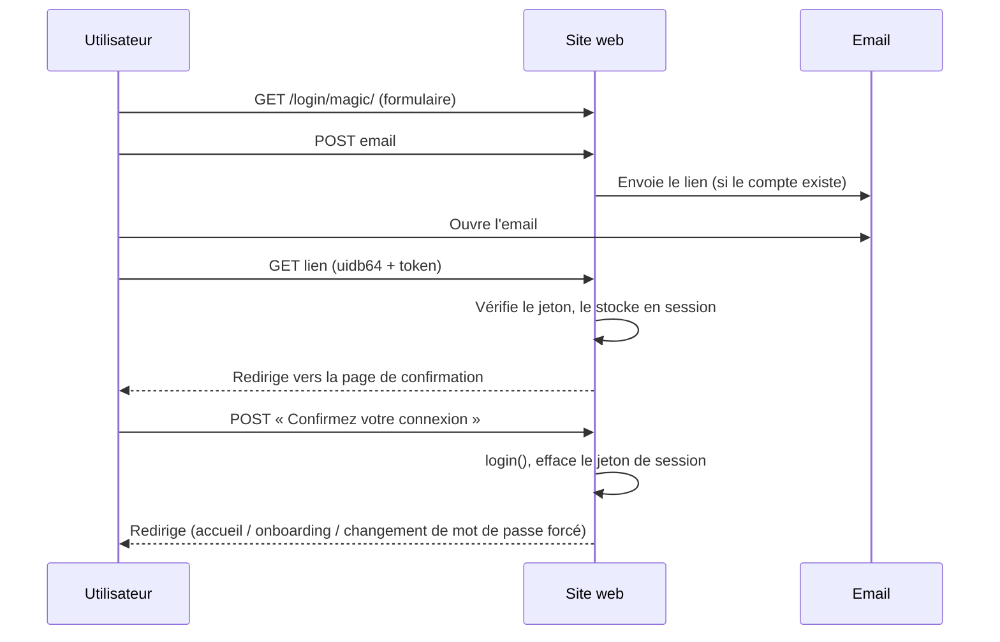

# Authentification

Il y a deux façons de se connecter au site :

- avec son email et son mot de passe ;
- avec un lien reçu par email (« lien magique »), sans mot de passe.

Cette page explique la seconde. Pour la liste des pages accessibles sans être connecté,
voir [`permissions.md`](permissions.md).

## Connexion par lien magique

### Déroulement

1. Sur la page de connexion, l'utilisateur clique sur « Recevez un lien de connexion
   par email ».
2. Il saisit son adresse email. Ce formulaire ne crée jamais de compte : il fonctionne
   seulement pour un compte qui existe déjà et qui est actif.
3. Si le compte existe, le site envoie un email avec un lien. Ce lien ne sert qu'une
   fois et expire après 15 minutes (réglable avec la variable d'environnement
   `MAGIC_LINK_TIMEOUT`, en secondes). La page affichée ensuite est toujours la même,
   que le compte existe ou non. Ainsi, personne ne peut savoir quelles adresses sont
   inscrites.
4. Quand l'utilisateur clique sur le lien, il n'est **pas** encore connecté. Le site
   vérifie le lien, puis affiche une page avec un bouton « Confirmez votre connexion ».
5. C'est le clic sur ce bouton qui connecte l'utilisateur. Ensuite, il est redirigé :
   vers le changement de mot de passe s'il est obligatoire, sinon vers l'accueil (ou
   vers la présentation du site lors de la première connexion).

### Pourquoi une étape de confirmation en deux temps ?

Certaines messageries et certains antivirus ouvrent les liens des emails pour les
analyser, avant que l'utilisateur ne clique. Le lien ne sert qu'une fois : sans
confirmation, cette analyse automatique l'utiliserait, et l'utilisateur recevrait un
lien déjà « usé ». Avec le bouton de confirmation, ouvrir le lien ne suffit pas pour se
connecter. Seul un vrai clic sur le bouton connecte l'utilisateur.

### Isolation du jeton de connexion

Les liens de connexion et les liens de réinitialisation du mot de passe utilisent des
jetons différents. Un lien de réinitialisation ne fonctionne pas comme lien de
connexion, et inversement.

C'est important : lors de la création de comptes en groupe, le staff voit à l'écran les
liens de réinitialisation. Sans cette séparation, un membre du staff pourrait utiliser
un de ces liens pour se connecter à la place d'un autre membre.

### Autres garanties

- Un compte désactivé ne peut pas se connecter par lien magique.
- Le lien ne peut pas rediriger vers une autre adresse (pas de paramètre `?next=`).
- Un utilisateur qui doit changer son mot de passe peut quand même terminer la
  connexion par lien.

### Pour aller plus loin

- Une page d'aide pour les membres explique la connexion par lien :
  `/annuaire/aide/connexion-par-lien/`.
- **Limite du nombre de demandes.** L'inscription, la réinitialisation du mot de passe
  et la demande de lien magique envoient des emails. Pour éviter les abus, chaque
  adresse email est limitée à 3 demandes par heure et 10 par jour. Chaque formulaire
  est aussi limité à 60 demandes par heure au total. Au-delà, le formulaire affiche une
  erreur (code HTTP 429). Le message est le même, que le compte existe ou non.
